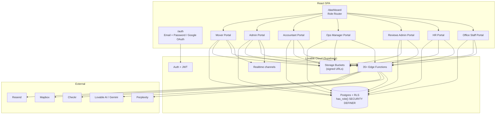
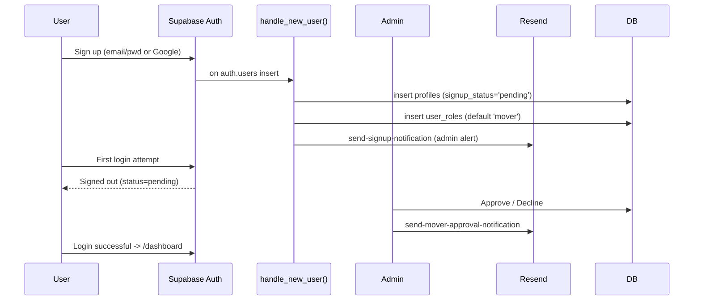
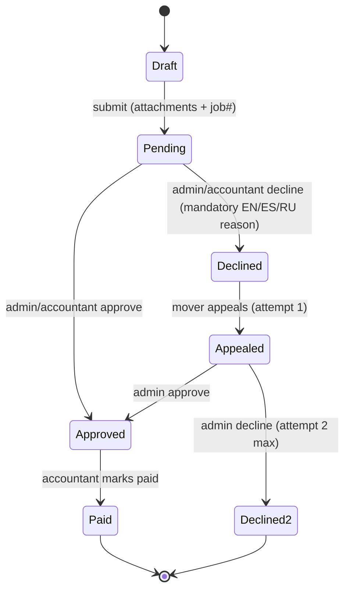
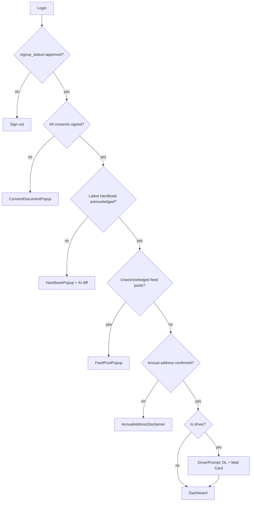
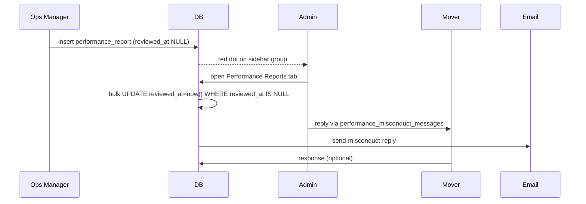
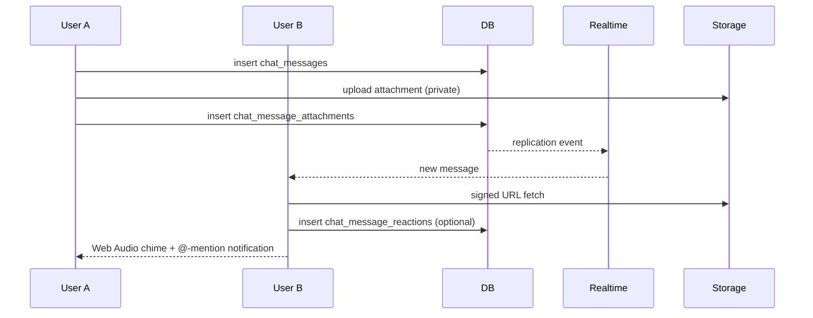
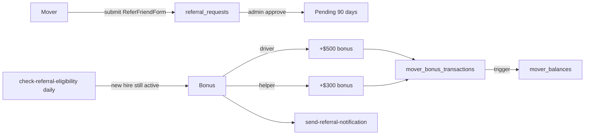

# MyProMovers — Architecture

A reference document for the MyProMovers reimbursement, compliance, and operations platform. It maps the role model, the data model, the supporting services, and the most important user flows.

---

## 1. Stack

| Layer | Technology |
|---|---|
| Frontend | React 18 + Vite + TypeScript, Tailwind CSS, shadcn/ui, framer-motion |
| Backend | Lovable Cloud (Supabase) — Postgres, Auth, Storage, Realtime, Edge Functions (Deno) |
| External | Resend (email), Mapbox (geocoding), Checkr (background checks), Lovable AI Gateway / Gemini (translation, handbook diffing), Perplexity (Admin AI Assistant) |
| i18n | EN / ES / RU with localStorage persistence + on-demand `translate-text` edge function for user-generated content |

The SPA exposes two top-level routes — `/auth` and `/dashboard` — and renders one of seven role-specific portals from `/dashboard`.

---

## 2. High-Level Architecture



---

## 3. Identity, Roles & Access Control

### 3.1 Signup & approval



### 3.2 Role enum (`public.app_role`)

`admin`, `accountant`, `mover`, `operations_manager`, `reviews_admin`, `hr_manager`, `office_staff`.

Roles live in `public.user_roles` (never on `profiles`). RLS uses `has_role(uid, role)` — a SECURITY DEFINER SQL function — to avoid recursive policy evaluation.

Router precedence at `/dashboard`:
**admin → reviews_admin → accountant → operations_manager → hr_manager → office_staff → mover**.

### 3.3 Role capability matrix

| Capability | Mover | Admin | Accountant | Ops Mgr | Reviews Admin | HR | Office |
|---|:-:|:-:|:-:|:-:|:-:|:-:|:-:|
| Submit reimbursements / appeals | ✅ | ✅ view | ✅ approve | — | — | — | — |
| Approve / decline reimbursements | — | ✅ | ✅ | — | — | — | — |
| Customer refunds — submit | ✅ | ✅ | ✅ | ✅ | — | — | ✅ |
| Customer refunds — process | — | ✅ | ✅ | — | — | — | — |
| Review bonuses — submit / appeal | ✅ | — | — | — | — | — | — |
| Review bonuses — approve | — | ✅ | — | — | ✅ | — | — |
| Missing payments — submit | ✅ | — | — | — | — | — | — |
| Missing payments — process | — | ✅ | — | — | ✅ | — | — |
| Performance / Misconduct submit | — | ✅ | — | ✅ | — | — | — |
| Performance / Misconduct manage | — | ✅ | — | — | — | — | — |
| Violence incidents — submit | ✅ | ✅ | — | ✅ | — | — | — |
| Violence incidents — review | — | ✅ | — | — | — | ✅ | — |
| Alcohol tests — submit | ✅ | — | — | ✅ | — | — | — |
| Alcohol tests — monitor | — | ✅ | — | — | — | ✅ | — |
| HR docs / driver document review | — | ✅ | — | — | — | ✅ | — |
| Manage user roles | — | ✅ | — | — | — | — | — |
| Manage feed / handbook / knowledge base | — | ✅ | — | — | — | — | — |
| Read feed | ✅ | ✅ | ✅ | ✅ | ✅ | ✅ | ✅ |
| Save feed posts | — | ✅ | — | — | — | — | ✅ |
| Chat | ✅ | ✅ | ✅ | ✅ | ✅ | ✅ | ✅ |
| Shift schedule clock-in | ✅ | — | — | — | — | — | — |
| Shift schedule manage | — | ✅ | — | — | — | ✅ | — |

---

## 4. The Seven Portals

### 4.1 Mover Portal (`MoverDashboard.tsx`)

Login is gated by a **mandatory blocking flow**:
**Consent docs → Handbook acknowledgment → Unread feed → Annual address confirmation → DL / Medical Card (if applicable).**

Functional areas:
- **To-Do List** — aggregates missing address, expired/missing DL & Med Card, declined HR docs, declined forms, unread handbook/consent.
- **Feed** — posts (text, images, video, polls), threaded comments, reactions, mandatory acknowledgment, "Save for later" counts, on-demand translation, real-time unacknowledged badge.
- **Reimbursement Form** — required attachments via transparent overlay, numeric job validation, debounced duplicate detection, history with two-attempt appeal flow and decline reasons.
- **Customer Review Bonus** — invoice + URL + up to 8 crew, unique-key validation (`check_duplicate_invoice_number`, `check_duplicate_review_url`), screenshot, appeal history.
- **Missing Payment** — discrepancy report with two-attempt appeal cycle.
- **Customer Refund Form** — Check method opens Mapbox address input; Zelle opens digits field.
- **Payment Questions** — threaded mover ↔ management with attachments.
- **Refer a Friend** — driver ($500) or moving helper ($300); eligibility evaluated by `check-referral-eligibility` cron after 3 months.
- **Performance / Misconduct cases** — view own cases, reply to admin via `performance_misconduct_messages`.
- **Workplace Violence Incident** — mobile-friendly Mapbox + photo / video.
- **Alcohol Test (BACtrack)** — weekly mandatory submission with photo.
- **Mover Feedback / Suggestions** — multilingual with priority levels.
- **Shift Schedule** — clock in/out, 15-minute incremental breaks.
- **Profile / Address / Driver Compliance** — Mapbox-geocoded address, annual confirmation, DL + Med Card upload with 90-day expiry warnings.
- **Chat** — 1-on-1 and groups, @-mentions, Web Audio chime, signed-URL attachments, inline audio player.
- **Knowledge Base Viewer** — role-shared, localized folders.
- **Notification Bell** — per-mover notification stream.

### 4.2 Admin Portal (`AdminDashboard.tsx`, `AdminSidebar.tsx`)

Sidebar layout: **Dashboard** + **Chat** standalone, then 7 workflow groups. Red-dot badges aggregate at the group level and clear via `reviewed_at` timestamps or explicit "viewed" actions.

- **User Management** — Signup Approvals, `UserRoleManager`, Movers Directory (balances, hourly rate, bonuses, deductibles, delete via `delete_user_account()`), User Activity Log.
- **Operations** — Shift Schedule, Referral Requests.
- **Compliance & Safety** — Misconduct submissions + responses, Violence Incidents, Alcohol Test Reports, Consent Document Manager.
- **Financial Management** — Customer Refunds (red-dot counts only pending), Deductibles Report, Missing Payments, Payment Questions, Reimbursements (approve/decline with mandatory EN/ES/RU explanation email).
- **Reports** — Reimbursement, Missing Payment, Customer Review, Mover Form reports with date filters + Excel export.
- **Content & Knowledge** — Feed Management (incl. scheduled posts via `publish-scheduled-posts`), Handbook Manager (AI diff via `compare-handbooks`), Knowledge Base, Mover Feedback.
- **Communication & Logs** — Email Logs, Admin AI Assistant (Perplexity), Send Mover Email.

### 4.3 Accountant Portal (`AccountantDashboard.tsx`)
Restricted financial cabinet: approve reimbursements, manage payment questions and deductibles, process customer refund payouts. Read-only mover balances and reports. No role/HR management.

### 4.4 Operations Manager Portal (`OperationsManagerDashboard.tsx`)
Field operations submissions: Performance/Misconduct reports (video attachments), Alcohol Test reports (RLS allows searching all profiles to assign tests), Violence Incidents, chat, feed.

### 4.5 Reviews Admin Portal (`ReviewsAdminDashboard.tsx`)
Customer review bonus pipeline + expanded scope for missing payments: approve/decline review bonuses with duplicate-checks, process missing payment submissions including the two-attempt appeal cycle, customer review reporting dashboard.

### 4.6 HR Portal (`HRDashboard.tsx`)
- **Employee Info** — job role (`Helper (K)`, `Helper`, `Foreman`, `Driver`, `Foreman & Driver`, `Office User`), branch, employment type, hire / termination, profile photo, license + physical with 90-day expiration alerts.
- **General** — emergency contacts, address history (auto-logged via `log_address_change` trigger), annual address confirmations.
- HR documents (private bucket, signed URLs), Driver Document Reviews (approve/decline DL + Med Card with email), Alcohol Test monitoring + zero-report alerts (`check-missing-alcohol-tests` + `send-alcohol-test-alert`), Violence Incidents read access.

### 4.7 Office Staff Portal (`OfficeStaffDashboard.tsx`)
Lightweight cabinet: feed with "Save post" bookmarking, customer refund submission, chat. No financial/HR/compliance writes.

---

## 5. Data Model Overview (~65 tables)

```mermaid
erDiagram
  profiles ||--o{ user_roles : has
  profiles ||--o{ address_history : logs
  profiles ||--o{ annual_address_confirmations : confirms
  profiles ||--o{ emergency_contacts : has
  profiles ||--o{ user_driver_status : has
  profiles ||--o{ hr_documents : has
  profiles ||--o{ user_activity_logs : generates

  profiles ||--o{ reimbursements : submits
  reimbursements ||--o{ reimbursement_attachments : has
  reimbursements ||--o{ reimbursement_appeal_attachments : has

  profiles ||--o{ customer_refunds : submits
  profiles ||--o{ missing_payments : submits
  profiles ||--o{ payment_questions : submits
  payment_questions ||--o{ payment_question_messages : has
  payment_questions ||--o{ payment_question_attachments : has

  profiles ||--o{ review_bonuses : submits
  review_bonuses ||--o{ review_appeal_attachments : has
  review_bonuses ||--o{ review_bonus_appeal_history : has

  profiles ||--o{ mover_balances : has
  profiles ||--o{ mover_bonus_transactions : records
  profiles ||--o{ deductibles : owes
  profiles ||--o{ shift_hourly_rates : has

  profiles ||--o{ performance_reports : involved
  performance_reports ||--o{ performance_report_attachments : has
  performance_reports ||--o{ performance_misconduct_messages : has

  profiles ||--o{ violence_incidents : reports
  violence_incidents ||--o{ violence_incident_attachments : has

  profiles ||--o{ alcohol_test_reports : submits
  profiles ||--o{ consent_acknowledgments : signs
  consent_documents ||--o{ consent_acknowledgments : has
  consent_documents ||--o{ signed_consent_documents : produces

  handbooks ||--o{ handbook_acknowledgments : has
  driver_document_reviews }o--|| profiles : reviews
  checkr_candidates }o--|| profiles : links

  profiles ||--o{ shifts : works
  shifts ||--o{ shift_breaks : has
  shifts ||--o{ shift_clock_entries : has
  profiles ||--o{ day_off_requests : requests
  profiles ||--o{ referral_requests : submits

  profiles ||--o{ conversation_participants : joins
  conversations ||--o{ conversation_participants : has
  conversations ||--o{ chat_messages : contains
  chat_messages ||--o{ chat_message_attachments : has
  chat_messages ||--o{ chat_message_reactions : has

  feed_posts ||--o{ feed_post_attachments : has
  feed_posts ||--o{ feed_post_comments : has
  feed_posts ||--o{ feed_post_reactions : has
  feed_posts ||--o{ feed_post_polls : has
  feed_post_polls ||--o{ feed_post_poll_options : has
  feed_post_poll_options ||--o{ feed_post_poll_votes : has
  feed_posts ||--o{ feed_post_acknowledgments : has
  feed_posts ||--o{ feed_post_views : has
  feed_posts ||--o{ feed_post_saves : bookmarked
  feed_posts ||--o{ feed_post_review_later_counts : has

  knowledge_base_folders ||--o{ knowledge_base_materials : contains
  knowledge_base_folders ||--o{ knowledge_base_folder_shares : has

  profiles ||--o{ mover_notifications : receives
  profiles ||--o{ mover_feedback : files
  mover_feedback ||--o{ mover_feedback_responses : has
  profiles ||--o{ job_assignments : on
  job_assignments ||--o{ mover_job_assignments : has
  job_assignments ||--o{ job_location_pings : tracks
```



### 5.1 Database functions (SECURITY DEFINER unless noted)

| Function | Purpose |
|---|---|
| `has_role(uid, role)` | RLS-safe role check |
| `is_conversation_participant(conv, uid)` | Chat RLS helper |
| `is_conversation_creator(conv, uid)` | Chat admin checks |
| `list_chat_users_for_picker(exclude_uid)` | Chat picker (filters admin/accountant for movers) |
| `delete_user_account(uid)` | Admin-only full deletion (cascades auth.users) |
| `handle_new_user()` | Profile + role row on signup |
| `update_mover_balance()` | Trigger on `mover_bonus_transactions` |
| `update_balance_on_deductible()` | Trigger inserts transaction on deductible insert |
| `revert_balance_on_deductible_delete()` | Reverts balance on deductible delete |
| `log_address_change()` | Appends to `address_history` |
| `check_duplicate_invoice_number(text)` | Review bonus uniqueness |
| `check_duplicate_review_url(text)` | Review bonus uniqueness |
| `get_email_by_username(text)` | Username→email lookup at login |
| `update_updated_at_column()` | Generic timestamp trigger |

### 5.2 Storage buckets

Private (signed URLs): `reimbursement-attachments`, `review-screenshots`, `performance-report-attachments`, `appeal-attachments`, `violence-incident-attachments`, `chat-attachments`, `hr-documents`, `driver-licenses`, `medical-cards`, `alcohol-test-photos`, `payment-question-attachments`, `referral-licenses`, `knowledge-base`.

Public: `profile-avatars`, `handbooks`, `feed-attachments`.

---

## 6. Edge Functions

### 6.1 Notifications (no links/buttons, except Checkr)

`send-reimbursement-notification`, `send-customer-refund-notification`, `send-performance-report-notification`, `send-misconduct-reply`, `send-appeal-notification`, `send-review-submission-notification`, `send-review-decline-notification`, `send-decline-notification`, `send-document-decline-notification`, `send-consent-notification`, `send-consent-admin-notification`, `send-mover-approval-notification`, `send-signup-notification`, `send-payment-question-notification`, `send-feedback-response`, `send-shift-notification`, `send-referral-notification`, `send-admin-reminder`, `send-alcohol-test-alert`, `send-confirmation-notification`, `send-mover-email`.

### 6.2 Cron / scheduled

| Function | Trigger | Purpose |
|---|---|---|
| `check-birthdays` | Daily | Auto-post birthday greeting in feed |
| `check-missing-alcohol-tests` | Weekly | Trigger zero-report alerts |
| `check-referral-eligibility` | Daily | Auto-bonus after 3 months |
| `publish-scheduled-posts` | Periodic | Publish admin-scheduled feed posts |

### 6.3 Integrations / utilities

`checkr-webhook`, `send-checkr-invitation`, `get-mapbox-token`, `translate-text` (Lovable AI / Gemini), `compare-handbooks` (AI diff), `admin-ai-assistant` (Perplexity), `confirm-job`, `receive-job-assignment`, `list-movers`.

---

## 7. Key Flows

### 7.1 Reimbursement lifecycle



### 7.2 Mover login compliance



### 7.3 Performance / Misconduct review tracking



### 7.4 Chat (real-time)



### 7.5 Referral auto-bonus



---

## 8. Cross-Cutting Conventions

- **Time:** all timestamps rendered in EST regardless of viewer.
- **Translation:** UI strings hard-coded EN/ES/RU; user-generated content uses `TranslateButton` -> `translate-text`.
- **Uploads:** transparent file-input overlay (`absolute inset-0 opacity-0`) for reliable mobile capture; every upload includes a removal control.
- **Forms:** high-contrast highlighted descriptions on top; calendars auto-close on selection.
- **Terminology:** "Approved", never "Confirmed".
- **Notifications:** red dots until viewed; cleared by `reviewed_at` timestamps; group-level aggregation in the Admin sidebar.
- **Security:** every public table has explicit `GRANT`s + RLS; cross-user operations go through SECURITY DEFINER functions; signed URLs for every private bucket attachment; edge functions verify JWT; anonymous access is fully blocked.
- **Emails:** transactional via Resend (`RESEND_API_KEY_1`); contain no links/buttons except Checkr invitations.

---

## 9. Repository Map (selected)

```
src/
  pages/
    Auth.tsx
    Dashboard.tsx          # Role router
    Index.tsx, NotFound.tsx
  components/dashboard/
    MoverDashboard.tsx / MoverSidebar.tsx
    AdminDashboard.tsx / AdminSidebar.tsx
    AccountantDashboard.tsx
    OperationsManagerDashboard.tsx
    ReviewsAdminDashboard.tsx
    HRDashboard.tsx / EmployeeInfoTab.tsx / EmployeeGeneralTab.tsx
    OfficeStaffDashboard.tsx
    chat/  feed/           # Feature subtrees
    (forms, lists, dashboards for every workflow listed above)
  integrations/supabase/   # Auto-generated client + types (do not edit)
  lib/                     # Translations, exports, storage helpers
supabase/
  functions/               # ~35 edge functions (see Section 6)
  migrations/              # All schema changes
```
